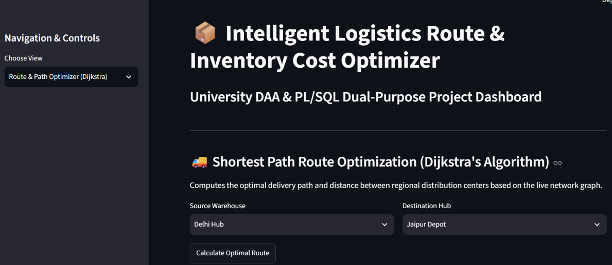
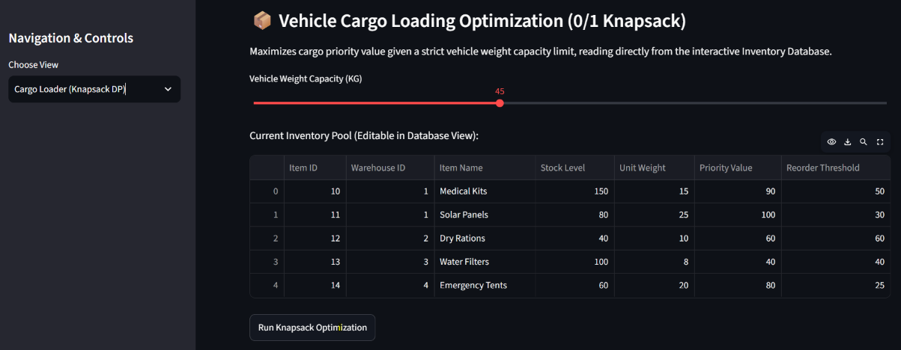
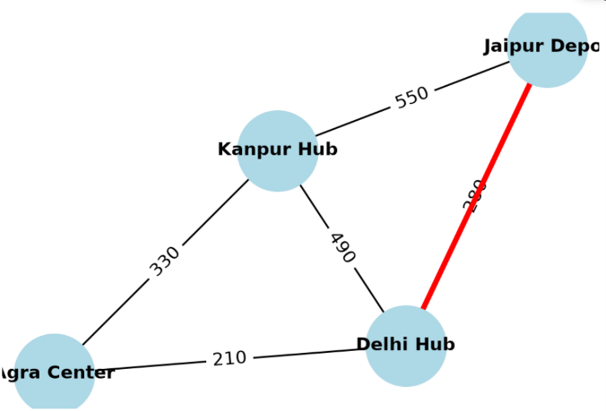
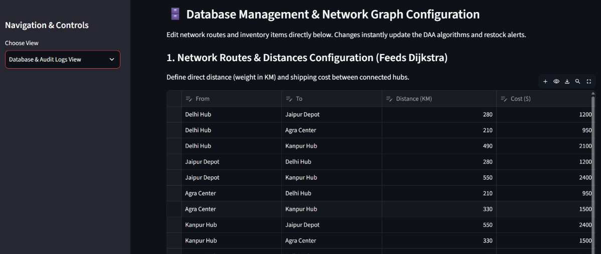

# Intelligent Logistics & DAA Optimizer

A Python-based logistics optimization project that uses graph visualization and algorithmic techniques to analyze and optimize routes.

## Features
- Interactive web interface using Streamlit
- Graph visualization
- Logistics route analysis
- Data visualization

## Tech Stack
- Python
- Streamlit
- NetworkX
- Matplotlib
- Pandas

## Installation

```bash
git clone https://github.com/ManishDecoded/Logistics-Optimizer.git
cd Logistics-Optimizer
pip install -r requirements.txt
streamlit run app.py
```

## Screenshots

### Dashboard


### 0/1 Knapsack


### Graph Visualization


### Editable Database


## Author

**Manish Decoded**  
MCA (AI & ML) Student | Chandigarh University

[GitHub Profile](https://github.com/ManishDecoded)
